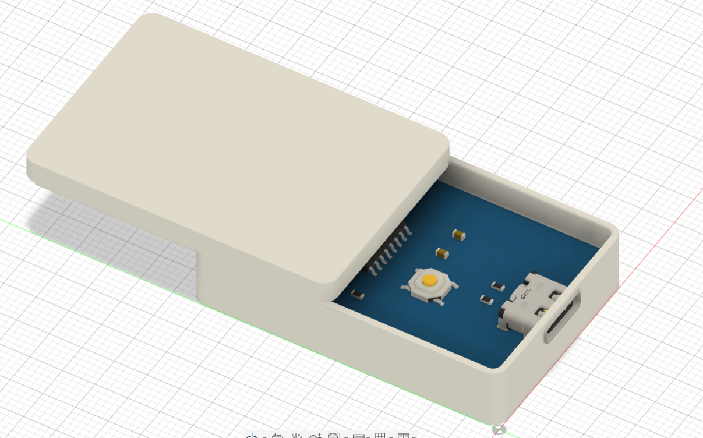
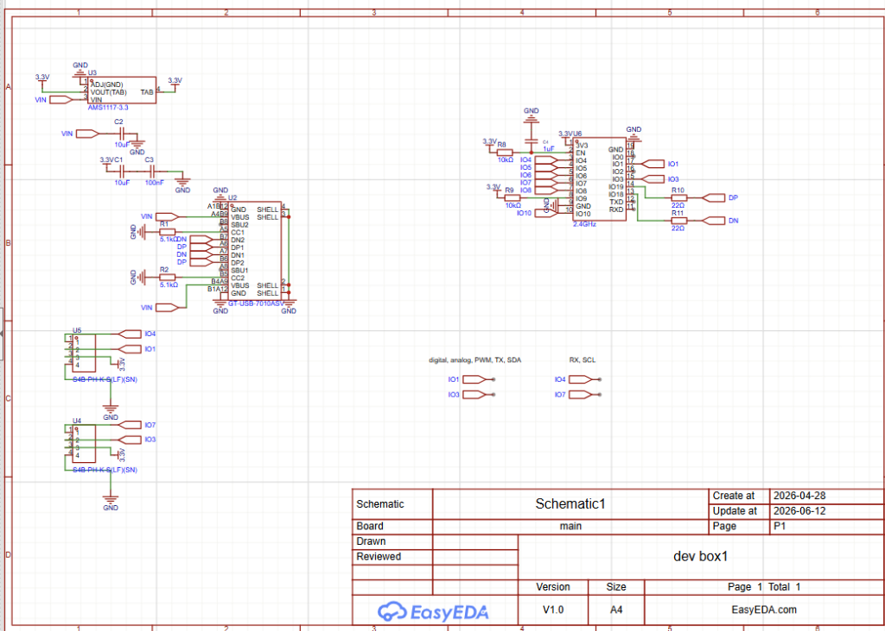
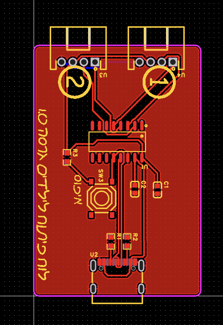
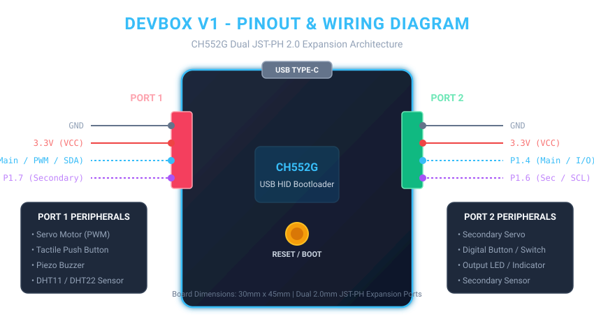
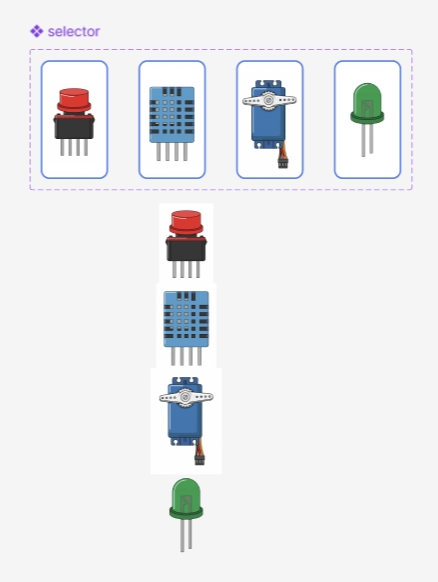

# Devbox V1

> **An ultra-low-cost, driverless physical computing kit and block programming platform powered by the WCH CH552G microcontroller.**



---

## 📌 Project Overview

**Devbox V1** is an all-in-one educational hardware and software ecosystem designed to make learning physical computing accessible, portable, and completely frictionless.

It features:
- **Custom Hardware:** A compact 30mm × 45mm custom PCB powered by the WCH CH552G 8051 USB microcontroller, housed in a custom 3D-printed snap/sliding enclosure.
- **Keyed Expansion Ports:** Dual 4-pin JST-PH 2.0mm keyed connectors (Port 1 & Port 2) preventing reversed polarity and eliminating loose breadboard jumper wires.
- **Zero-Driver WebHID Bootloader:** Custom-written C firmware running on the CH552 that flashes over standard USB HID. No Zadig, WinUSB, or vendor drivers are needed—works straight out of the box on school Chromebooks, Windows, Linux, and Android.
- **Visual Block Programming:** A custom Blockly-based web workspace (`webBlocks`) that converts graphical logic blocks into C / Arduino code.
- **Cloud Compilation Engine:** A stateless FastAPI backend (`API`) that runs `arduino-cli` with `CH55xDuino` to compile code on the fly and stream flashable binaries directly into the browser.

---

## 💡 Why I Made Devbox V1

Most beginner electronics platforms (Arduino Uno, ESP32, micro:bit) cost between $15 to $35+, and setting them up in classrooms or clubs is often frustrating. School laptops and Chromebooks frequently block serial driver installation (CH340/CP2102) and lack administrative permissions to configure COM ports or run native IDEs. Furthermore, delicate breadboards and messy jumper wires break constantly when transported.

I built Devbox V1 to solve this:
1. **Under $2 Total Bill of Materials:** The entire custom board costs less than $1.50 in components, making classroom sets affordable on any budget.
2. **Zero-Driver Plug & Play:** By engineering a custom USB HID bootloader, users can plug the device into any modern web browser (WebHID) and flash it in under a second with zero drivers or native software installation.
3. **Durable, Keyed Modularity:** Keyed JST-PH ports ensure students cannot plug sensors in backwards or short out power rails, protected inside a rugged 3D-printed enclosure.

---

## 📸 Project Pictures & Media

### 1. Full 3D CAD Assembly & Enclosure
The complete 3D CAD model showing the custom PCB seated inside the 3D-printed sliding case, with USB-C and expansion port cutouts:


*CAD files available in [`hardware/cad/board_enclosure.step`](hardware/cad/board_enclosure.step) (.STEP) and [`hardware/cad/board_enclosure.f3d`](hardware/cad/board_enclosure.f3d) (Fusion 360 source).*

---

### 2. Custom PCB Design & Schematic
The custom 30mm × 45mm 2-layer PCB designed in EasyEDA Pro, routing the CH552G MCU, decoupling capacitors, USB-C CC logic, and dual expansion headers:

| Schematic | PCB Layout & Silkscreen |
| :---: | :---: |
|  |  |

*Full PCB production Gerbers are in [`hardware/pcb/gerbers.zip`](hardware/pcb/gerbers.zip) and EasyEDA Pro project in [`hardware/pcb/dev_box1.eprj`](hardware/pcb/dev_box1.eprj).*

---

### 3. Wiring & Pinout Architecture
Devbox V1 routes microcontroller pins to two standardized 4-pin expansion connectors:



| Port | Pin 1 | Pin 2 | Pin 3 (Main Signal) | Pin 4 (Secondary Signal) | Compatible Modules |
| :--- | :--- | :--- | :--- | :--- | :--- |
| **Port 1** | GND | 3.3V | **P1.5** (PWM / SDA) | **P1.7** (GPIO) | Servo Motor, Tactile Button, Buzzer, DHT11/22 |
| **Port 2** | GND | 3.3V | **P1.4** (GPIO / ADC) | **P1.6** (SCL) | Secondary Servo, LEDs, Digital Inputs, Sensors |

---

### 3. Modular Peripherals & Visual Blocks
The block interface allows drag-and-drop programming tailored specifically to Devbox V1's hardware modules:



---

## 📂 Repository Layout

```text
DevboxV1/
├── BOM.csv                       # Bill of Materials with supplier links & unit costs
├── README.md                     # Main project documentation & grant overview
├── hardware/
│   ├── cad/
│   │   ├── board_enclosure.f3d   # Autodesk Fusion 360 parametric CAD source
│   │   └── board_enclosure.step  # Full 3D CAD assembly (PCB + enclosure)
│   └── pcb/
│       ├── dev_box1.eprj         # EasyEDA Pro project database & schematics
│       ├── gerbers.zip           # Production Gerber and NC drill files (JLCPCB ready)
│       ├── Info_PCB.txt          # Board specifications (30x45mm, 2 layers, 10 components)
│       └── schematic_dxf.zip     # DXF vector schematic export
├── HIDUploader/
│   ├── firmware/                 # CH552 USB HID Bootloader (SDCC C source & build)
│   │   ├── src/                  # bootloader.c, usb_hid.c, iap_flash.c
│   │   └── build/                # Compiled .hex and .bin bootloader images
│   ├── web/                      # WebHID browser flasher (HTML5 / Vanilla JS PWA)
│   ├── android/                  # Android native USB HID flasher app
│   └── python/                   # CLI cross-platform flasher utility
├── API/                          # Cloud compilation backend (FastAPI + arduino-cli)
└── webBlocks/                    # Blockly visual block programming frontend
```

---

## 🛠️ Bill of Materials (BOM)

*All components are sourced for maximum cost efficiency through LCSC and JLCPCB:*

| Item | Designator | Description | Qty | Footprint | Supplier | Part Number | Unit Cost | Link |
| :--- | :--- | :--- | :---: | :--- | :--- | :--- | :---: | :--- |
| **MCU** | U1 | WCH CH552G 8051 USB Microcontroller | 1 | SOP-16 | LCSC | [C111292](https://www.lcsc.com/product-detail/C111292.html) | $0.38 | [LCSC](https://www.lcsc.com/product-detail/C111292.html) |
| **USB** | USB1 | USB Type-C 16-Pin Receptacle | 1 | SMD-16P | LCSC | [C5187472](https://www.lcsc.com/product-detail/C5187472.html) | $0.14 | [LCSC](https://www.lcsc.com/product-detail/C5187472.html) |
| **Headers** | U3, U4 | JST-PH 2.0mm 4-Pin Right Angle Connector | 2 | CONN-TH_4P | LCSC | [C157926](https://www.lcsc.com/product-detail/C157926.html) | $0.10 | [LCSC](https://www.lcsc.com/product-detail/C157926.html) |
| **Button** | SW3 | Tactile Push Button (Reset/Bootloader) | 1 | SMD-4P | LCSC | [C318884](https://www.lcsc.com/product-detail/C318884.html) | $0.04 | [LCSC](https://www.lcsc.com/product-detail/C318884.html) |
| **Capacitors** | C1, C2 | 100nF 50V X7R Ceramic Capacitor | 2 | 0603 | LCSC | [C14663](https://www.lcsc.com/product-detail/C14663.html) | $0.01 | [LCSC](https://www.lcsc.com/product-detail/C14663.html) |
| **Resistor** | R3 | 10kΩ 5% Pull-Up Resistor | 1 | 0603 | LCSC | [C98220](https://www.lcsc.com/product-detail/C98220.html) | $0.01 | [LCSC](https://www.lcsc.com/product-detail/C98220.html) |
| **Resistors** | R4, R5 | 5.1kΩ 1% Type-C CC Pull-Down Resistors | 2 | 0603 | LCSC | [C122969](https://www.lcsc.com/product-detail/C122969.html) | $0.01 | [LCSC](https://www.lcsc.com/product-detail/C122969.html) |
| **PCB** | PCB | Custom 2-Layer FR-4 (30mm × 45mm) | 1 | 30x45mm | JLCPCB | Custom | $0.40 | [JLCPCB](https://jlcpcb.com) |
| **Enclosure** | Case | 3D Printed PETG/PLA Sliding Case (~25g) | 1 | Custom 3D | Self / Hub | Custom | $0.50 | [3D Print](https://jlcpcb.com/3d-printing) |
| **TOTAL** | | **Complete Unit Cost** | | | | | **~$1.60** | |

*(See full machine-readable [`BOM.csv`](BOM.csv) in repository root)*

---

## 📜 License
Devbox V1 hardware and firmware are open-source under the GNU General Public License v3.0 (see [LICENSE](LICENSE)).
